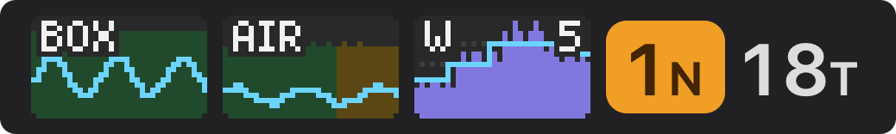

# BeszelBar, agents fork

[](https://github.com/evoleinik/BeszelBar/actions/workflows/checks.yml)

A fork of [BeszelBar](https://github.com/Loriage/BeszelBar) by Loriage that puts live pixel graphs
of your servers and Macs in the menu bar, and shows which coding-agent sessions need you. The agent
counts come from [agent-exporter](https://github.com/evoleinik/agent-exporter).



*Drawn by the app's own code from sample data (`scripts/render-readme-images.sh`).*

Left to right: one graph per machine (cyan CPU line, RAM area coloured by memory pressure), W for
working agent sessions over the last hour with a cyan median per 16 minutes, then N for sessions
that need you and T for finished turns waiting for your next message.

## What this fork adds

- **Live graphs in the menu bar.** One graph per machine: a cyan CPU line over the RAM area, drawn on the pixel grid with no smoothing. The RAM area is dark green, yellow or red by memory pressure, as Activity Monitor does, muted so the CPU line stays clear on top, from `memory_pressure_level` (agent-exporter's `scripts/mem-pressure.sh`). It is grey on a machine that sends no pressure. The machine name sits in the top-left corner in a 4×6 pixel font. It subscribes to Beszel's `rt_metrics` realtime feed, the web UI's one-second feed. Readings are averaged into one point per 9 seconds. Each graph holds one point per pixel column, so it covers 5 minutes, as Stats does by default, and old points only scroll, never redraw. On start, the hub's last five one-minute rows fill each graph, and live points push them out. Servers come first, then Macs. Graphs match Stats' height.
- **Work graph and counts.** W graphs working sessions over the last 68 minutes, one column per two minutes. A cyan step line shows the median of each 16-minute block, fixed in clock time, and the corner number is the newest block's median, the last step. N counts sessions that need you, in an amber pill. T counts finished turns waiting for your next message. Every gap in the item is 3 points.
- **Agents section and waiting badge.** These read agent-exporter's custom metrics from `custom_stats`. That collection needs Beszel with henrygd/beszel#2562.
- **Checks.** Run `scripts/check-live.sh` for the stream parser, topic encoding, averaging and geometry. Run `scripts/check-agent-stats.sh [record.json]` for the agent metric parser.
- **Build and install.** Run `scripts/build-local.sh` on the Mac. It signs ad hoc with a fixed rule, the bundle id, so the keychain sees each rebuild as the same app and one "Always Allow" lasts. It works over SSH too.
- **HTTPS.** macOS blocks plain HTTP to an IP address, so give the hub an HTTPS URL, for example through `tailscale serve`.

## Install this fork

There is no signed release of this fork. Build it on the Mac:

```bash
git clone -b agents https://github.com/evoleinik/BeszelBar.git
cd BeszelBar
scripts/build-local.sh   # needs Xcode and xcodegen; installs to ~/Applications and launches it
```

The agent counts need a hub from Beszel's custom-metrics pull request
[#2562](https://github.com/henrygd/beszel/pull/2562) and agent-exporter on the machine that runs
the agents. Without them, the graphs and everything below still work.

---

The rest of this page is the upstream README.

## Installation

### Homebrew

```bash
brew install --cask loriage/tap/beszelbar
```

### Download

Download the latest release from the [Releases](https://github.com/Loriage/BeszelBar/releases) page.

The app is signed and notarized by Apple, so macOS should recognize it as a trusted build when you install it.

### Build from source

```bash
# Requires Xcode 15+ and xcodegen
brew install xcodegen
git clone https://github.com/Loriage/BeszelBar.git
cd BeszelBar
./build.sh
open build/Release/BeszelBar.app
```

## Screenshot


## Features

- **Live system cards** — See all your servers with status indicators, CPU, memory, and disk at a glance
- **Rich system details** — Hover for detailed metrics including temperature, uptime, and usage bars
- **Container monitoring** — View Docker containers with health status, resource usage, and image info
- **Alert notifications** — Active alerts displayed prominently with triggering conditions
- **Multi-hub support** — Connect multiple Beszel instances and switch between them instantly
- **Native performance** — Built with SwiftUI and AppKit for minimal resource usage
- **Secure authentication** — Credentials stored safely in macOS Keychain
- **Auto-refresh** — Configurable polling interval from 10 seconds to 5 minutes

## Setup

1. Launch BeszelBar
2. Click the menu bar icon and open **Settings**
3. Add your Beszel hub URL, email, and password
4. Your servers will appear in the menu bar dropdown

BeszelBar supports both password and JWT token authentication. Tokens are automatically refreshed when needed.

## Requirements

- macOS 14.0 (Sonoma) or later
- A running [Beszel](https://github.com/henrygd/beszel) hub instance

## Acknowledgements

A huge thank you to [henrygd](https://github.com/henrygd) for creating Beszel, a fantastic, lightweight, and open-source monitoring tool. This mobile client would not exist without his remarkable work.

## License

MIT License — see [LICENSE](LICENSE) for details.
